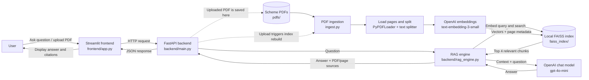

# Krishi-Sahayak: Agricultural Scheme Assistant

Krishi-Sahayak is a retrieval-augmented question-answering app for agricultural scheme documents. It searches PDF files, uses OpenAI embeddings and a language model to form an answer, and displays the source PDF and page references. The project includes a FastAPI backend and a Streamlit chat interface.

## How it works

1. PDFs in `agri-rag-bot/pdfs/` are loaded and split into overlapping text chunks.
2. OpenAI `text-embedding-3-small` embeddings are stored in a local FAISS index at `agri-rag-bot/faiss_index/`.
3. For each question, the backend retrieves the four most relevant chunks and asks `gpt-4o-mini` to answer using only those documents.
4. The frontend displays the answer and source PDF/page references.

The answer is limited to the documents in the local knowledge base; it does not fetch current information from the web.

## Architecture



The solid arrows show the normal question-answering and indexing flows. Dashed arrows show the PDF upload path: after uploading, restart the backend so it reloads the rebuilt FAISS index.

## Main tools and components

| Tool or technology | How this project uses it |
|---|---|
| Python | Programming language used for the backend, frontend, and PDF indexing script. |
| Streamlit | Builds the browser-based chat interface and PDF upload control in `frontend/app.py`. |
| FastAPI | Implements the backend web server and HTTP endpoints in `backend/main.py`. |
| Uvicorn | Runs the FastAPI server during development. |
| HTTP API (REST-style) | Lets the frontend send questions and PDF uploads to the backend. For example, `POST /ask` accepts a question and returns an answer and sources. |
| `requests` | Makes HTTP calls from the Streamlit frontend to the FastAPI backend. |
| LangChain | Connects the PDF loader, text splitter, embeddings, FAISS retriever, prompt, and language model into the RAG workflow. |
| OpenAI API | Creates text embeddings with `text-embedding-3-small` and generates answers with `gpt-4o-mini`. |
| FAISS | Stores and searches document vectors locally in `faiss_index/`; this is a vector index, not a traditional SQL database. |
| PyPDF / `PyPDFLoader` | Reads PDF pages and retains page metadata used for source citations. |
| `python-dotenv` | Loads `OPENAI_API_KEY` from the local `.env` file. |

### What frontend, backend, and API mean here

- **Frontend:** The part a person interacts with in their web browser. Here, Streamlit displays the chat, sample questions, answers, and PDF upload control.
- **Backend:** The server-side part that handles requests and performs application work. Here, FastAPI validates questions and uploads, while the RAG engine searches the index and calls OpenAI.
- **API:** The defined communication interface between frontend and backend. The frontend sends an HTTP request to an endpoint such as `POST /ask`; the backend returns structured JSON containing the answer and source references.
- **RAG (retrieval-augmented generation):** The approach used to answer questions: retrieve relevant passages from the project's PDFs, then give those passages to the language model as context for its answer.
- **Embedding:** A numerical representation of text that lets the system find passages with similar meaning, even when they do not use exactly the same words as the question.
- **Vector index:** The searchable local collection of embedded PDF chunks. In this project it is the FAISS index in `faiss_index/`.

## Inputs and outputs

### Inputs

- **User question:** A question entered in the Streamlit chat, such as “What subsidy is available for farm machinery?” The frontend sends it to the backend as JSON: `{"question": "..."}`.
- **Scheme PDFs:** Documents in `pdfs/` provide the source content. Users can also upload a PDF through the frontend; the backend saves it and rebuilds the FAISS index.
- **OpenAI API key:** `OPENAI_API_KEY` in the local `.env` file authorizes calls to OpenAI for embeddings and answer generation. It is configuration, not a chat input.

### Outputs

- **Answer:** A response generated from the relevant passages retrieved from the indexed PDFs. If the documents do not provide the requested information, the assistant is instructed to say so.
- **Source references:** The PDF filename and page number associated with retrieved passages, returned by the API and displayed below the answer.
- **Updated search index:** PDF ingestion or upload rebuilds the local FAISS index so the documents can be searched. Restart the backend after an upload so it loads the rebuilt index.

## Project layout

```text
.
├── README.md
└── agri-rag-bot/
    ├── backend/
    │   ├── main.py          # FastAPI API
    │   └── rag_engine.py    # FAISS retrieval and answer generation
    ├── frontend/
    │   └── app.py           # Streamlit chat interface
    ├── faiss_index/         # Persisted vector index
    ├── pdfs/                # Source scheme PDFs
    ├── ingest.py            # Build/rebuild the vector index
    └── step1_verify.py      # Check API key and PDF loading
```

## Requirements

- Python 3.10 or later
- An OpenAI API key with access to the embedding and chat models used by the app
- Internet access when creating embeddings or answering questions

## Setup (Windows PowerShell)

Run these commands from the repository root:

```powershell
cd .\agri-rag-bot
py -m venv .venv
.\.venv\Scripts\Activate.ps1
python -m pip install --upgrade pip
python -m pip install fastapi uvicorn python-multipart streamlit requests python-dotenv langchain-openai langchain-community langchain-text-splitters faiss-cpu pypdf
```

If PowerShell prevents virtual-environment activation, allow scripts for the current terminal session and activate again:

```powershell
Set-ExecutionPolicy -Scope Process -ExecutionPolicy Bypass
.\.venv\Scripts\Activate.ps1
```

Create `agri-rag-bot/.env` with your own API key:

```dotenv
OPENAI_API_KEY=your_openai_api_key
```

Do not commit `.env` or share your API key.

## Build the document index

The repository includes a persisted FAISS index. If the index is missing, or whenever you add or change PDFs manually, rebuild it from the `agri-rag-bot` directory with the virtual environment activated:

```powershell
python ingest.py
```

This reads the PDFs in `pdfs/` and writes the index files into `faiss_index/`. Building the index calls the OpenAI embeddings API and may incur usage charges.

To check that the API key is loaded and the PDFs can be read:

```powershell
python step1_verify.py
```

## Run the application

Keep the virtual environment activated. Start the backend and frontend in **separate PowerShell terminals**. Run the following commands in each terminal from the repository root; each command changes into `agri-rag-bot`.

Terminal 1 — FastAPI backend:

```powershell
cd .\agri-rag-bot
.\.venv\Scripts\Activate.ps1
python -m uvicorn backend.main:app --reload
```

Terminal 2 — Streamlit frontend:

```powershell
cd .\agri-rag-bot
.\.venv\Scripts\Activate.ps1
python -m streamlit run frontend/app.py
```

Open the Streamlit URL shown in the terminal (normally `http://localhost:8501`). The API is available at `http://127.0.0.1:8000`, and its interactive documentation is at `http://127.0.0.1:8000/docs`.

## API endpoints

| Method | Path | Purpose |
|---|---|---|
| `GET` | `/` | Check that the backend is online |
| `POST` | `/ask` | Ask a question; JSON body: `{"question": "..."}` |
| `POST` | `/upload-pdf` | Upload a PDF and rebuild the persisted FAISS index |

Uploaded PDFs are saved under `pdfs/`. After uploading a PDF, restart the backend so its in-memory retriever loads the rebuilt index before asking questions about the new document.

## Troubleshooting

- **Missing OpenAI API key:** Confirm `agri-rag-bot/.env` contains `OPENAI_API_KEY=...` and restart the backend.
- **FAISS index not found:** From `agri-rag-bot`, activate the environment and run `python ingest.py`.
- **Frontend cannot connect:** Confirm the backend is running at `http://127.0.0.1:8000` before starting or using Streamlit.
- **New or edited PDFs do not appear in answers:** Rebuild the index with `python ingest.py`, then restart the backend. After using the upload control, restart the backend as well.

## Notes

- Answers depend on the coverage and quality of the PDFs provided. Verify important eligibility, subsidy, and application details against the original documents.
- The API is configured for local development and does not include authentication. Do not expose it directly to the public internet.
